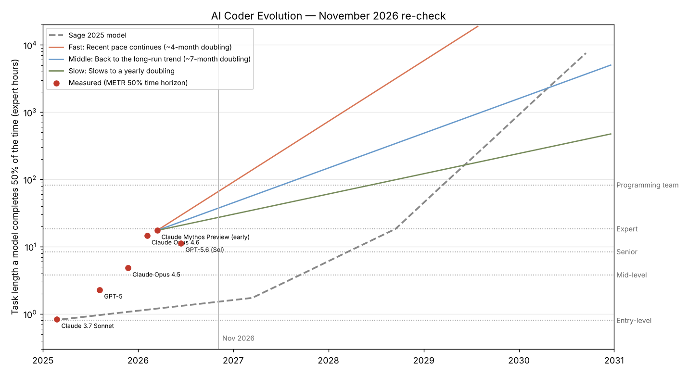

# November 2026 re-check

> Sage's March 2025 model, scored against what actually happened by 6 November 2026.

## How the comparison works

Sage's capability units never had a real-world scale. To check them against reality they are tied to **METR's 50% time horizon**: the length of software task (timed on a human expert) that an AI agent completes half the time. The anchor is one point: **350 units (Sage's "entry-level programmer", 2025 H1) = ~50 minutes**, Claude 3.7 Sonnet's horizon when METR published the method in March 2025. Every other Sage level scales in proportion.

A different anchor would shift every crossing date. The growth-rate comparison doesn't depend on it.

## Findings

| Sage level | Task length | Sage forecast | Crossed | By |
|---|---|---|---|---|
| Entry-level | 0.8 h | 2025 H1 | Feb 2025 | Claude 3.7 Sonnet (anchor) |
| Mid-level | 3.8 h | 2027 H2 | **Nov 2025** | Claude Opus 4.5 (~4.8 h) |
| Senior | 8.4 h | 2028 H1 | **Feb 2026** | Claude Opus 4.6 (~14.5 h) |
| Expert | 18.4 h | 2028 H2 | Unconfirmed | Mythos Preview measured ≥16 h (95% CI 8.5–55 h) |
| Programming team | 82.8 h | 2029 H1 | Not yet | — |

**Growth per six months**

| Rate | × per 6 months |
|---|---|
| Sage: baseline, to 2027 | 1.2× |
| Sage: self-improvement, 2027–28 | 2.2× |
| Sage: quantum, 2028 on | 4.5× |
| Measured: long-run trend 2019–24 (7-month doubling) | 1.81× |
| Measured: 2024–Feb 2026 (~105-day doubling) | 3.34× |

For early 2026 Sage's curve expected about **1.2 h**; the best measured model reached about **17.4 h**.

### Scoring Sage's 2025 model

- **Direction: right.** Capability compounded, and 2027 looks like the year AI starts doing much of its own research. OpenAI says it reached its "automated research intern" goal in September 2026 (agents logged 3.1 workdays per human workday in August), with a full automated researcher targeted for March 2028.
- **Pace: too slow at first.** The 20% baseline was the biggest miss. Reasoning models trained with reinforcement learning pushed growth past Sage's *self-improvement* rate in 2024–25, before any self-improvement.
- **Mechanisms: partly wrong.** The quantum boost hasn't arrived; broad quantum speed-ups of AI training are still several hardware generations away. Diffusion models are fast (Mercury 2 in Feb, Mercury 3 in Oct 2026) but not yet at the frontier.
- **What it can't show.** Benchmarks crossed "senior programmer" in early 2026, yet overall developer job postings rose ~11% in 2026 while employment of developers aged 22–25 fell ~20% since late 2022 (Stanford AI Index). A task-length score is not a job.
- **The ruler ran out.** METR can't reliably measure beyond ~16 hours and has published no new frontier points since May 2026, so newer models (Claude Opus 5 / 5.5, Fable 5.1, GPT-6 Astra) aren't on the chart.
- **On sentience.** None of these curves measures awareness. The mid-2027 crossing in the original graph is about coding work.

### Projections from the best measurement (Mythos Preview, Mar 2026)

| Task length | Fast (~4-month doubling) | Middle (~7-month) | Slow (12-month) |
|---|---|---|---|
| A working week (40 h) | Aug 2026 | Nov 2026 | May 2027 |
| Sage's "programming team" (83 h) | Dec 2026 | Jul 2027 | Jun 2028 |
| A working month (167 h) | Apr 2027 | Feb 2028 | Jun 2029 |
| A working year (2,000 h) | Jun 2028 | Mar 2030 | Jan 2033 |

These are benchmark task-length milestones, not jobs replaced. Even the fast path's first milestone can't be confirmed while the measuring suite tops out at ~16 hours.

## Files

| File | What it is |
|---|---|
| `data/*.json` | The datasets: METR measurements, Sage's curve and levels, growth rates, scenarios, milestones, 2026 events |
| `build_data.py` | Regenerates the JSON files (Sage curve maths and the unit mapping) |
| `chart.py` | Draws `chart.png` from the JSON (`python chart.py`, needs matplotlib) |
| `chart.png` | The static chart above |

An interactive version was built as a Claude dashboard (private to Tom).

## Sources

- [METR — time horizon table (Wikipedia)](https://en.wikipedia.org/wiki/METR)
- [METR time horizons v1.1 data (DataLearner)](https://www.datalearner.com/en/benchmarks/metr-time-horizons-v1-1)
- [Claude Mythos shows 16+ hour time horizon (OfficeChai)](https://officechai.com/ai/claude-mythos-shows-50-time-horizon-of-16-hours-on-metr-benchmark/)
- [Best AI time horizon by August 2026 (Manifold)](https://manifold.markets/event/best-ai-time-horizon-by-august-2026)
- [Research acceleration: the view inside OpenAI](https://openai.com/index/research-acceleration-view-inside-openai/)
- [OpenAI hits 'automated research intern' milestone (AI Weekly)](https://aiweekly.co/alerts/openai-says-it-hit-automated-research-intern-milestone)
- [SWE-bench Pro leaderboard (BenchLM)](https://benchlm.ai/benchmarks/swe-bench-pro)
- [Stanford AI Index: junior developer employment](https://www.mexc.com/news/1024589)
- [Developer jobs growing in 2026 (AIxploria)](https://www.aixploria.com/en/ai-radar/ai-developer-jobs-data-growth-not-collapse/)
- [Mercury 3 review (The Neuron)](https://theneuron.ai/news/mercury-3-review-diffusion-language-models)
- [Quantum AI computing, September 2026 (Skycrumbs)](https://skycrumbs.com/blog/quantum-ai-computing-september-2026)

*Prepared by Arc (Claude), 6 November 2026.*
